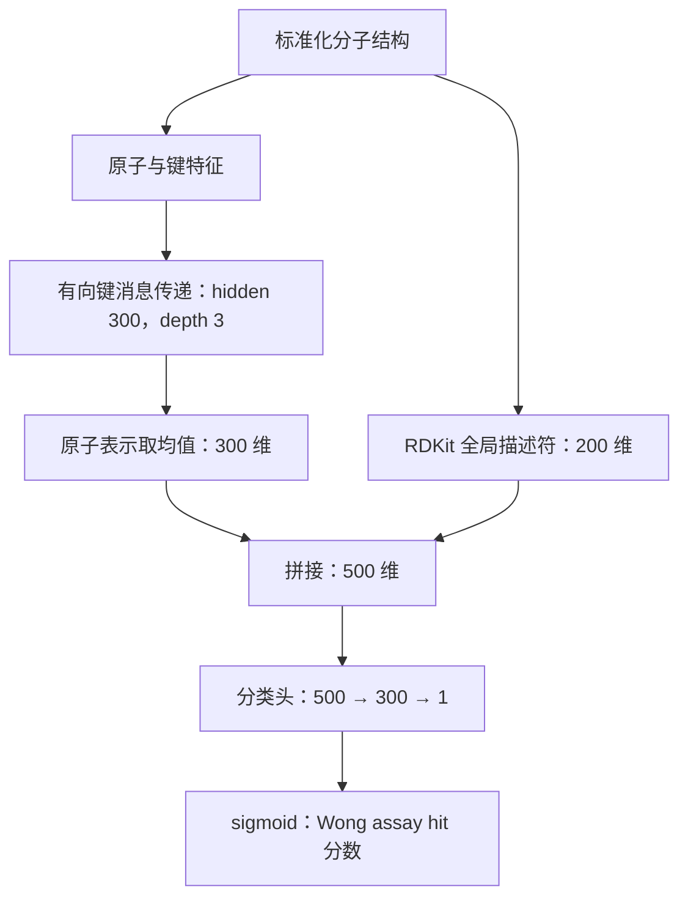

# 生物学目标、assay 与当前 D-MPNN：讨论准备

更新：2026-09-10。依据本地 Wong PDF、已安装 Chemprop 2.2.1 源码、冻结配置与本轮数据审计。说明当前实现，不把它描述成完整复现或最优模型。

## 1. X、Y 与最终应用

- X 是已知化合物的标准化结构；当前不是菌株基因组、BGC、培养液或混合提取物。
- Y 是明确条件下的 whole-cell 生长抑制。当前为 S. aureus RN4220、50 µM、两个重复的平均相对生长 <0.2 时 hit=1，否则 hit=0。
- 放线菌是候选化合物的**来源**，S. aureus 是活性测试的**对象**。放线菌产生的纯化化合物完全可以用 S. aureus assay 评价；这就是逻辑连接。来源尚未知或没有放线菌独立评价时，不能声称模型已在该来源上泛化。
- Wong 主筛回答固定剂量下是否强烈抑制生长；MIC 回答在指定培养条件和生长判据下，最低哪个受测浓度能抑制生长。两者与抗菌优先排序有关，但不是同一个标签。不能从 50 µM 的 hit 反推出精确 MIC，也不能由该标签推断安全、杀菌、其他菌株活性或临床疗效。
- 同 assay/同单位中，MIC=4 比 MIC=32 表示更低剂量即可抑制生长。`>32` 只给下界。32 µg/mL 对 MW=400 的分子是 80 µM，对 MW=800 的分子是 40 µM；统一质量浓度并非统一分子数浓度。
- Wong 数据适合作为可追溯起点，但不是完美数据。原论文有 biological replicates 和再测；重复并非完全一致。数据清理、独立划分、化学空间覆盖及未来目标来源评价仍然必要。

## 2. “干净”不等于“全部来自完全相同的 assay”

可靠数据要求结构—测量对应正确、条件可追踪、单位/不等号明确、未知不当阴性、重复差异有记录、评价集不泄漏。统一 assay 简化这些问题，但不是跨 assay 学习的理论前提。

同一化合物在低剂量 inactive、高剂量 active 可能都正确；删除剂量再拼成两个相反标签，才造成信息缺失。菌株、培养基和时间变化也可能改变真实反应，不一定只是噪声。

可行的学习方式包括：同类单位的可靠换算；共享化学编码器但保留每个 assay 的独立输出；先用辅助 assay 学表示，再在目标 assay 微调；用 meta-learning 学一个容易被少量目标数据适配的初始化。ActFound 通过同 assay 内的活性差值和跨任务学习利用异质数据；差值可抵消共享加性偏移，不能保证消除菌株特异性、化合物特异性实验干扰或错误记录。

因此，不应把“meta-learning 能处理差异”说成“任意标签混合后都可以修复”。也不应在没有本任务实验时断言一定失败。2026 年抗菌植物天然产物再利用研究有少样本相对收益，但绝对准确度受限，是需要小规模验证的直接证据。

### 有限投入的决定

主线先做简单的辅助 assay 迁移。CO-ADD 单浓度数据若不能重建作者 hit 判据，仍可研究原始连续 inhibition 作为**独立辅助目标**；不能把它冒称作者 binary hit。目标 Wong 的 BCE 分类和辅助任务的连续响应需要各自的输出与损失。是否确实有用由固定比较决定，不先全面训练 ActFound。

辅助集明确排除评价化合物，严格骨架协议还控制骨架重叠；先固定一组数据、一个轻量迁移方案、三个配对 seeds 和评价规则。若没有可重复的增益，不继续扩大同一路线的调参预算。新的独立评价仍要另外建立，不能“重置”已经查看的 test。

## 3. GNN、MPNN、D-MPNN

GNN 是处理图的神经网络大类。MPNN 通过邻接关系交换数值向量信息。我们的 D-MPNN 使用**有方向的化学键**作为消息状态，A→B 与 B→A 各有一个状态。“有方向”是计算表示，不表示化学键只沿一个方向存在。

### 输入与前向计算

1. 标准化 SMILES 转分子图；原子为节点、键为边。每原子 72 维输入，包含元素、连接数、电荷、氢数、杂化、芳香性、手性标签与质量等；每键 14 维，包含键类型、共轭、环与立体信息。当前没有 3D 坐标或蛋白结构输入。
2. 将一个有向键的起点原子特征 72 维与键特征 14 维拼接，得到 86 维输入，通过学习矩阵得到 300 维键状态。
3. 汇总进入起点原子的邻接键消息，排除立即沿同一条键反向返回的消息，再经共享权重与 ReLU 更新。depth=3 在 Chemprop 2.2.1 中指初始化后执行两轮递归更新，再读出原子表示；不是训练 3 个 epochs。
4. 汇总进入每个原子的键消息，与原始原子特征拼接，经 372→300 变换得到原子表示。对全分子的原子表示取均值，得到 300 维分子向量。不同原子数的分子因此都能输入同一个分类器。
5. 拼接由结构直接计算的 200 个固定归一化 RDKit 描述符，得到 500 维输入。描述符补充整体性质，不是 200 个新实验测量或新样本。
6. 分类头为 500→300→1，中间使用 ReLU；最后 sigmoid 输出 0–1 hit 分数。外部天然产物库中分数尚未经概率校准，不能把 0.8 当已证明有 80% 实验成功率。

分子中一个氧原子可以影响相邻碳的表示，随消息更新影响更远的局部环境。训练学习这些结构环境与实验标签之间的统计关系，不是在模拟分子真实运动，也没有自动证明作用机制。

### 与源码一致的可选公式

令 x_v 为原子输入，e_vw 为键输入，|| 为拼接，σ 为 ReLU。

- 初始线性状态 z⁰_vw = W_i[x_v || e_vw]，初始激活 h⁰_vw = σ(z⁰_vw)。
- 更新时 mᵗ_vw = Σ hᵗ⁻¹_uv，求和遍历 u∈N(v)、u≠w。
- hᵗ_vw = σ(z⁰_vw + W_h mᵗ_vw)，当前执行 t=1,2 两轮。
- 原子表示 h_v = σ(W_o[x_v || Σ h²_uv])，再对原子取平均。

同一套 W_i/W_h/W_o 用于不同位置和不同分子；网络无需为每个新化合物重新定义参数。

## 4. 一次训练怎样进行

训练集为 31,058 个化合物，validation 为 3,821 个。每次取 32 个训练分子，前向得到分数/对应 logits，用真实 0/1 标签计算 binary cross-entropy，再反向传播计算梯度，由 Adam 更新权重。每个 epoch 遍历训练集约 971 个 batches，最后不足 32 个也保留。

损失为 BCE：L=−mean[y log p+(1−y)log(1−p)]；实现用 logits 版本以提高数值稳定性。**优化 BCE，使用 validation AP 选择 checkpoint**，不是直接对 AP 求梯度。validation 不参与梯度更新，但它参与模型选择，所以分数仍有选择偏差。

每个 epoch 后评估 validation AP；最多 20 epochs，至少 5 epochs，连续 5 次验证不改善则提前停止，最后恢复 AP 最佳 checkpoint。十个模型在同一个固定训练/验证划分上训练，seed 改变初始化和样本顺序，最后对分数等权平均；这不是十折交叉验证。

## 5. 参数与超参数

**参数**是通过梯度学习的权重和偏置：当前共 378,301 个，其中消息传递部分 227,700，分类头 150,601。无描述符版本少 60,000 个输入层权重。

**超参数**是训练前选择的设置：

- hidden_dim=300：每个隐藏表示的数值维度；增加容量也增加资源与过拟合风险，不是 300 个原子。
- depth=3：控制信息传播范围；不是越深一定越好。
- 分类头一个隐藏层、300 单元；mean pooling 固定。
- batch_size=32：一次权重更新所用分子数，不是总样本数。
- Adam 学习率从 1e-4 在前两轮升至 1e-3，再按预定 20 轮日程衰减至 1e-4；提前停止时未必到达最终学习率。
- dropout=0、batch normalization 关闭；没有类别重采样和额外正类权重。保留这些设置是为了轻量且一致的对照，不代表它们普遍最优。
- 最多 20 epochs、early-stopping patience=5；CPU 两线程是运行资源设置，不决定模型的生物学目标。

目前没有大规模搜索这些超参数；Wong 原文做了超参数搜索，不能将我们的轻量实现称为完整复现。合理的下一轮搜索应先固定数据、标签、划分与预算，做少量预定配置，用 validation 比较，再用配对 seeds 看稳定性，最后以新的未使用评价来源检验泛化。更多 seeds 只能检验训练随机性，不能弥补评价集重复使用。

## 6. 汇报时应表达的结论

我们构建了结构到指定 S. aureus whole-cell hit 的可复现预测管线，用轻量 D-MPNN 学习局部结构表示，并拼接全局描述符。描述符改善 validation 的整体排序，但十成员集成未超过近邻的 Top-50 命中数。下一步检验保留 assay 身份的辅助数据是否有益；放线菌来源外推与真实实验验证尚未完成。

来源：Wong 等，Nature 2024，PDF 第 2 页与 Methods；[论文 DOI](https://doi.org/10.1038/s41586-023-06887-8)。本机配置 `configs/chemprop_descriptors_v1.json`；模型构建 `src/antibacterial/neural_descriptors.py`；已安装 Chemprop 2.2.1 的 `BondMessagePassing`、`MPNN.configure_optimizers` 与 featurizers 实查。[Chemprop 消息传递说明](https://chemprop.readthedocs.io/en/latest/tutorial/python/models/message_passing.html)。[抗菌天然产物 ActFound 再利用研究](https://www.nature.com/articles/s42256-026-01187-y)。
