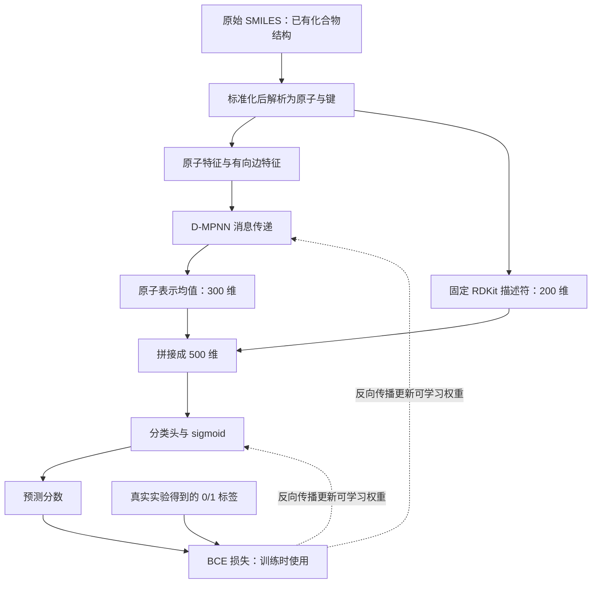

# 从原始实验数据到 D-MPNN 训练：本项目的详细说明

更新：2026-09-10。本文可以单独带到新聊天中阅读。它解释当前项目实际使用的数据和模型，而不是泛泛介绍所有 GNN。

项目目录：`/Users/tt/Documents/ChatGPT/Train an antibiotic optimization model`。

**先回答最重要的问题：原始训练数据已经包含化合物结构。结构以 SMILES 文本保存。我们把已有结构转换成图，并用实验测量得到的活性标签监督训练；不是让模型根据抗菌活性猜结构。**

建议先读第 1–6 节，理解一行数据怎样变成模型输入；再读第 7–12 节理解消息传递和训练。公式是补充，可以第二遍再读。

## 1. 我们究竟在学习什么？

当前任务为：

> 已知化合物的结构 → 预测它在指定 S. aureus 实验条件下是否强烈抑制生长。

这里必须分开两个东西：

- **X，输入：**化合物结构，以及从结构计算的特征。
- **Y，正确答案：**真实实验测量所对应的 hit/non-hit 标签。

当前实验对象是金黄色葡萄球菌 *Staphylococcus aureus* RN4220，浓度为 50 µM。平均相对生长小于 0.2 时，Y=1；否则 Y=0。

模型当前不预测精确 MIC，也不直接预测是否安全、是否能治疗感染、由哪种放线菌产生，或混合提取物是否有效。放线菌是未来候选化合物的来源；S. aureus 是被测试的目标菌。

## 2. 最初下载的训练数据长什么样？是否包括结构？

**包括。我们保存了两个相互核对的原始文件。**

### 2.1 作者的示例训练 CSV

文件：[author_train.csv](<data/raw/wong2024/author_train.csv>)。

它包含两个业务字段：

```text
SMILES    化合物结构的文本表示
ACTIVITY  作者提供的 0/1 活性标签
```

它不是只有“化合物名字 + 是否抗菌”。SMILES 已经提供了原子种类、连接关系及可表达的立体信息。作者提供结构，并不意味着这些结构是我们通过模型发现的。

### 2.2 论文的原始补充测量表

文件：[supplementary_data_1.xlsx](<data/raw/wong2024/supplementary_data_1.xlsx>)。

工作表 `S. aureus growth inhibition` 的字段是：

```text
Compound_ID  化合物编号
SMILES       化合物结构
R1_50uM      第一次重复的相对生长
R2_50uM      第二次重复的相对生长
Mean_50uM    作者报告的平均相对生长
```

我们需要这份表，因为它让二分类标签可以追溯到实验测量。按照 `Mean_50uM < 0.2` 重新计算标签后，我们检查了它与作者 CSV 是否一致，而不是直接相信文件名字叫“train”就开始训练。

原始表有 39,312 行、512 个 hits。结构标准化、重复和冲突处理后，固定数据集有 38,823 个化合物、484 个 hits。其中：

- train：31,058 个化合物，用于梯度更新。
- validation：3,821 个，用于开发比较和选择 checkpoint。
- test：3,944 个，用于此前冻结协议后的最终评价。这个 test 已经查看过，后续不能再称为全新的独立评价。

这些数字对应不同处理阶段，不能把原始 39,312 行直接等同于当前训练集的 31,058 个独立化合物。

## 3. 跟踪一条真实训练记录

下面是真实数据，**不是为说明原理而编造的实验结果**。

原始工作表第 225 行：

```text
Compound_ID = BRD-A56592690
SMILES      = CC[C@@H](C)SSc1ncc[nH]1
R1_50uM     = 0.134126077
R2_50uM     = 0.154605678
Mean_50uM   = 0.144365877
```

两个重复的平均约为 0.1444，低于 0.2，因此作者标签为 `ACTIVITY=1`。这里的 0.1444 是相对生长，不是“模型预测准确率”，也不是 MIC。

同一条记录在本项目中的追踪信息：

```json
{
  "record_id": "wong2024:225",
  "source_compound_id": "BRD-A56592690",
  "parent_smiles": "CC[C@@H](C)SSc1ncc[nH]1",
  "compound_key": "BPBPYQWMFCTCNG-ZCFIWIBFSA-N",
  "activity": 1,
  "split": "train"
}
```

这条记录标准化前后的 SMILES 相同，并非所有化合物都会相同。`compound_key` 是用来检查身份和重复的 InChIKey，不是送给网络学习的一串“特征数字”。

`measurement_count=1`（如查看处理后的记录时看到它）指合并后对应一条原始测量记录，不表示该实验只有一次 biological replicate；原始行中仍然包含 R1 和 R2。

最关键的数据边界：**SMILES 进入输入构造；activity 进入损失计算。R1、R2、Mean 不能作为这个抗菌预测模型的输入，否则等于提前把答案交给模型。**

## 4. SMILES 是什么？“把结构转成图”是什么意思？

SMILES 是表示分子结构的一种文本语法，不是化合物的自然语言名称，也不是结构图片。

用 `CCO` 作一个简单的**结构教学例子**：

```text
SMILES：CCO
连接图：C—C—O
原子编号：0—1—2
```

这个例子只解释结构编码，本文没有给乙醇添加任何假设的抗菌标签。

SMILES 中常见符号包括：

- `C`、`N`、`O`、`S`：元素。
- `=`：双键，例如 `C=O`。
- `(...)`：分支，并非一个额外原子。
- 小写 `c`、`n`：芳香原子。
- `1` 等数字：环闭合标记，不是“这里有 1 个碳”。
- `[C@@H]` 等括号表示：包含手性、氢等信息。
- `.`：不同连接片段，例如一些盐形式。多个有机片段需要核查，不能总是假定最大片段就是唯一有效药物。

同一结构可能有多种合法 SMILES 写法。因此我们需要标准化和身份检查，不能只用字符串相同与否判断是否为同一化合物。

**转换由 RDKit 的确定性化学解析程序完成，不需要神经网络训练。** 程序读取 SMILES，建立原子对象和化学键对象，并检查结构是否能被解析。随后 Chemprop 把这些对象编码成数值数组。

我们的实际路径是：

```text
论文提供的 SMILES
→ RDKit 解析和本项目结构标准化
→ parent_smiles
→ MoleculeDatapoint.from_smi(...)
→ RDKit 分子对象
→ SimpleMoleculeMolGraphFeaturizer
→ 网络可读取的图数组
```

当前模型没有输入分子的 3D 构象。结构未知的提取物不能靠填写一个名字直接进入这条管线；首先需要可用的化合物结构。

## 5. 图不只是画出来的连线：还需要数值特征

网络接收的是数组，而不是“看”一张化学结构图。

### 5.1 节点：原子及其特征

当前 Chemprop 2.2.1 默认编码给每个原子一个 72 维向量。它包含元素、总连接数、电荷、手性、氢数、杂化、芳香性和质量等信息。

很多类别用 one-hot 编码。例如简化的元素分类：

```text
类别顺序假设为：[C, N, O]
C → [1, 0, 0]
N → [0, 1, 0]
O → [0, 0, 1]
```

这只是 one-hot 原理示意；不是我们完整 72 维向量的实际列顺序。实际编码还有更多元素、其他属性以及未知类别的位置。质量使用连续数值编码，不是所有维度都为 0 或 1。

SMILES 通常不把每个氢都展开成独立节点。当前真实例子有 11 个图节点；原子的氢数等信息仍包含在特征里，例如第一个碳的特征反映它带有三个氢。`[nH]` 也不表示必须额外创建一个 H 节点。

### 5.2 边：化学键及其特征

每个键方向有一个 14 维向量，包括单/双/三/芳香键、共轭、是否在环中、立体信息等。

图的连接关系单独保存。例如 `CCO` 有两条化学键：0—1、1—2；D-MPNN 使用四个有向边记录：

```text
0→1，1→0，1→2，2→1
```

“有向”只是为了计算消息而选择的表示，不是说分子中有四条不同化学键，也不是说化学键只朝一个方向起作用。

## 6. 真实例子变成了哪些数组？

对第 3 节的真实化合物，本轮用实际 featurizer 核对得到：

```text
原子数                       11
无向化学键数                 11
有向边数                     22
原子特征 V 的形状            [11, 72]
有向键特征 E 的形状          [22, 14]
连接索引 edge_index 的形状   [2, 22]
反向边索引的形状             [22]
```

`[11,72]` 的意思是：11 行分别对应 11 个原子，每行有 72 个数。它不是 11 个化合物，也不是 72 次实验。

`edge_index` 的每一列保存一个方向的起点和终点。例如前四列为：

```text
起点：0  1  1  2
终点：1  0  2  1
```

反向边索引让程序知道 0→1 对应的反向边是 1→0。

目前为止，这些图和特征都是从结构计算出来的；**还没有学习任何抗菌规律**。

## 7. GNN、MPNN、D-MPNN 的关系

- GNN：处理图数据的神经网络大类。
- MPNN：通过相邻元素之间传递消息，更新隐藏表示的一类 GNN。
- D-MPNN：这里指以有向键状态为基础的 message-passing 网络。

“消息”不是一句文字，也不是化合物间发生了化学反应，而是一组数值向量。

原始原子特征告诉网络“这个位置是怎样的原子”；消息传递让隐藏向量逐渐反映“它处于怎样的局部化学环境”。例如同为碳，连接氧、氮或硫时，其环境不同，学到的表示可以不同。

## 8. 一轮消息传递具体怎样计算？

### 8.1 先初始化每个有向键

以 v→w 为例，拼接起点原子的 72 维特征和键的 14 维特征，得到 86 个数。

一个可学习线性层把它转换为 300 维。这里的权重开始于随机初始化，之后通过训练更新。

```text
72 维原子特征 + 14 维键特征
→ 86 维输入
→ 可学习线性变换
→ 300 维初始键状态
```

“300 维”不是 300 个原子，也不是我们人为定义了 300 种抗菌性质。它是允许模型学习的数值表示空间。

### 8.2 收集邻居信息并更新

更新 v→w 时，汇总进入 v 的其他方向消息，但排除 w→v。这样避免在一次更新中把刚沿同一条边返回的信息直接算入。

汇总后经可学习权重变换，与初始线性状态相加，再通过 ReLU。ReLU 的计算是 `max(0,x)`，提供非线性，使模型不只是一连串线性变换。

同一套更新权重用于所有位置、所有分子；不是每个原子都有一套完全独立的模型。

### 8.3 depth=3 到底是什么意思？

在我们使用的 Chemprop 2.2.1 源码中：先初始化，再执行 `range(1, depth)` 的更新。因此 depth=3 对应**初始化后两轮递归消息更新**，随后读出原子表示。

depth 控制结构信息传播的范围；epoch 控制训练集被遍历多少遍。两者不是同一个概念。也不能把 depth=3 简单理解成“模型总共只有三个神经网络层”。

### 8.4 可选公式：与当前源码一致

令 x_v 为原子特征，e_vw 为键特征，|| 为拼接，ReLU 为激活函数。

```text
z0_vw = W_i [x_v || e_vw]
h0_vw = ReLU(z0_vw)

m_t_vw = sum(h_(t-1)_uv)，其中 u 是 v 的邻居且 u ≠ w
h_t_vw = ReLU(z0_vw + W_h m_t_vw)
```

我们执行 t=1、2。W_i 和 W_h 是被学习的参数；向量 h 是给定分子在当前权重下计算出的中间结果。**隐藏表示不是额外的实验标签。**

## 9. 怎样从很多原子变成一个分子的预测？

### 9.1 键表示 → 原子表示 → 分子表示

先汇总进入各原子的键消息，与该原子的原始 72 维特征拼接，经 372→300 的线性变换和 ReLU，得到每个原子的 300 维表示。

真实例子得到 `[11,300]` 的原子表示。对 11 个原子的向量逐维取均值（mean pooling），变成 `[1,300]` 的分子表示。

大分子、小分子都变成 300 维，因此同一个分类器能处理不同大小的结构。均值汇聚不会为每个原子保留一个单独输出，也不是把原子坐标取平均。

### 9.2 加入 200 个全局描述符

另一路从结构计算 `RDKit2DNormalized` 的 200 个描述符。它们提供分子整体性质等信息，有助于补充局部消息传递和均值汇聚可能难以表达的内容。

```text
学习得到的分子表示：[1,300]
由结构计算的描述符：[1,200]
拼接后的表示：      [1,500]
```

描述符不需要新增 wet-lab 实验。它们没有带来 200 个新化合物，也没有带来 200 个活性测量。固定描述符计算本身不由当前 BCE 训练更新；网络会学习怎样利用它们。

使用的是 descriptastorus 的固定参考归一化，不是把本次 train/validation/test 一起拟合缩放器。个别非有限描述符按预定规则填 0 并记录；计算失败则停止。处理规则不能在看到评价结果后随意改变。

### 9.3 分类头输出一个分数

```text
500 维输入 → 300 单元隐藏层 → 1 个 logit → sigmoid → 0–1 分数
```

sigmoid 是 `1/(1+exp(-z))`，把任意实数 logit 转为 0–1。分数用于排序；外部候选库中的概率校准尚未验证，不能把分数 0.8 直接当作已证实的 80% 实验成功率。



## 10. “训练”究竟改变了什么？

训练不会修改化合物的原子和键，也不会把测量标签变成模型希望的答案。改变的是网络的**权重和偏置**。

一次更新的顺序：

1. 从训练集抽取一批结构与标签。
2. 前向计算图表示和预测分数。
3. 将预测与真实标签比较，计算损失。
4. 反向传播：计算损失对各参数的梯度。
5. Adam 根据梯度更新参数。
6. 换下一批样本，重复。

梯度可以理解为：“如果这个参数稍微变化，当前损失会怎样变化？”它不是人手指出哪个化学片段一定抗菌。

### BCE 的直观例子

以下预测值是**教学假设，不是第 3 节化合物的实际预测**。

假设真实标签 y=1：预测 p=0.1 时，损失为 `-log(0.1)≈2.303`；预测 p=0.9 时，损失为 `-log(0.9)≈0.105`。对真实 inactive 的样本，反过来，高分会受惩罚。

```text
BCE = -mean[y*log(p) + (1-y)*log(1-p)]
```

实际实现使用 logits 形式以保持数值稳定。当前没有类别重采样或额外正类权重。

**训练优化 BCE，不是直接优化 AP。** AP 用于每轮后的 validation 评价和 checkpoint 选择。

## 11. 一个 batch 里面是什么？

batch_size=32 表示一次更新最多使用 32 个分子，不是 32 个原子。

32 个分子可能各有不同原子数。Chemprop 将它们放进一个由 32 个互不连通子图组成的批图，并记录每个原子属于哪个分子。

```text
批图原子特征：[本批所有分子的原子总数,72]
批图有向键特征：[本批所有有向边总数,14]
分子归属索引：标记每个原子所属分子
全局描述符：[32,200]
真实标签：  [32,1]
预测分数：  [32,1]
```

pooling 按分子分别做，不会将第一个化合物的原子与第二个化合物混成一个分子向量。消息传递也不在这 32 个化合物之间建立新的化学键。

训练集 31,058 个分子，每轮有约 971 个 batches。最后一个 batch 不足 32 个也保留。当前按需构建图、未缓存全量图，因此训练过程中会重复进行图特征构建；原始测量文件不会因此改变。

## 12. train、validation、test 和 checkpoint 的作用

**Train：**用于梯度更新。网络通过它学习权重。

**Validation：**不用来计算训练梯度，但用来选择超参数/最佳 epoch。因此它参与开发，不能说“因为没有反向传播，所以 validation 完全独立”。

**Test：**在方案固定后用于最终评价。我们的 V0 test 已经使用过，此后继续开发不能消除这一历史。

本项目按分子骨架 scaffold 分组划分，避免同一母体或同一骨架同时进入不同集合；还检查了 InChIKey、标准化结构和不含立体标记的连接结构。这样的划分比简单随机分行更能检验对未见结构组的泛化，但仍不能保证对所有天然产物或放线菌化合物可靠。

一个 epoch 后计算 validation AP。最多训练 20 个 epochs，至少 5 个；连续 5 次验证不改善时提前停止。最终恢复 validation AP 最佳 checkpoint，而不是自动使用最后一轮。

checkpoint 保存训练所得权重，恢复文件还可包含优化器等状态。它不是新数据集，也不是论文。

## 13. 参数、超参数和 seed 分别是什么？

### 参数：训练自动学习的数字

当前模型有 378,301 个可训练参数：消息传递部分 227,700，分类头 150,601。它们包括线性层权重和偏置。无描述符模型少了 60,000 个输入层权重。

### 超参数：我们先选择的设置

- hidden_dim=300：隐藏向量宽度，影响容量和计算量。
- depth=3：消息传播深度。
- 分类头一个 300 单元隐藏层：控制分子向量如何映射到输出。
- mean pooling：从原子汇总到分子的方式。
- batch_size=32：每次更新使用的分子数。
- Adam 学习率：起始 1e-4，前两轮升至 1e-3，再按 20 轮日程衰减至 1e-4；提前停止时可能尚未到达最终学习率。
- dropout=0，batch normalization 关闭。
- 最大 20 epochs，early-stopping patience=5。

这是本机可运行、便于对照的轻量配置。我们没有完成大规模 hyperparameter optimization，也没有证明它最优。调参应使用固定开发规则和预算；不能看到 test 不好就反复调到 test 变好，再称其为独立结果。

### Seed：控制训练中的随机过程

不同 seed 会改变初始随机权重和样本打乱顺序。因此，同一种方法在同一份数据上可能得到略不同的排序。

我们训练十个模型，是十套独立学习到的权重，使用同一组固定 train/validation 数据。最后对同一化合物的十个分数取平均形成 ensemble。这不是十种架构，也不是十折交叉验证；不是把十个 AP 分数平均后当作 ensemble 的 AP。

## 14. 模型训练完成后，如何用于新化合物？

新化合物只需要可用结构，不必先有标签才能得到预测：

```text
新化合物 SMILES
→ 同样的结构标准化、图编码和描述符计算
→ 使用已训练好的权重
→ 得到分数并排序
```

但没有真实测量，就不能知道这条预测是否正确。**产生预测不需要标签；验证预测需要标签。** 在未来实验中测量高分候选后，才能计算真实命中率、判断是否有新抗菌发现。

模型不能通过高分证明结构新颖、来源为放线菌、机制明确或对人体安全；这些需要其他数据和实验。

## 15. 为什么简单近邻有时不输给 MPNN？

模型更复杂不保证当前数据足够支持它学习更好的规律。相似结构可能已经提供强信号，而有限活性样本、化学空间分布、测量噪声和训练配置都可能影响结果。

当前 validation 三成员无描述符 ensemble 的 AP 为 0.3713，加描述符后为 0.4125；十成员为 0.4150。Top-50 对应 22、22、20 个已知 positives；近邻为 22。因此描述符改善整体排序，但十成员未带来 Top-50 的优势。这是开发集结果，不是新的独立实验成功率。

## 16. 下一阶段的数据会怎样进入模型？

目标 Wong 标签保持不变。CO-ADD 的另一个固定 assay 可以作为辅助任务：先学习它的连续 inhibition，再将学到的图编码器转移到 Wong 分类任务。

两种输出不应混为一谈：

- 辅助任务：结构 → CO-ADD 指定条件下的连续 inhibition，使用单独的回归输出与损失。
- 目标任务：结构 → Wong 指定条件下的 0/1 hit，使用分类输出与 BCE。

迁移的是学到的表示/参数，不是声称这两个实验的 Y 完全一样。准备辅助数据时需要移除评价集结构与骨架重叠。是否真的改善预测，必须通过固定对照实验检验。

## 17. 可以直接给新聊天的上下文

> 我正在做一个基于 Wong S. aureus RN4220 50 µM 筛选数据的结构到抗菌 hit 预测项目。当前模型是 Chemprop 2.2.1 的 D-MPNN：72 维原子特征、14 维键特征，hidden=300、depth=3，mean pooling 后拼接 200 个 RDKit2DNormalized 描述符，分类头 500→300→1。用 BCE 和 Adam 训练，用 validation AP 选择 checkpoint。请以本文为上下文，用中文从我不理解的步骤继续解释，区分真实项目数据、教学假设和一般理论。不要假定当前标签是 MIC，也不要把十个 seeds 说成十折交叉验证。

## 18. 原始文件、实现和核对入口

- 原始来源与哈希：[manifest.json](<data/raw/wong2024/manifest.json>)。
- 从 workbook 核对标签：[extract_wong.py](<scripts/extract_wong.py>)。
- 结构清理规则：[chemistry.py](<src/antibacterial/chemistry.py>)。
- 当前训练集：[train.parquet](<data/processed/wong_v0/train.parquet>)。Parquet 是机器可读表格格式，不是神经网络权重文件。
- 模型构造与描述符输入：[neural_descriptors.py](<src/antibacterial/neural_descriptors.py>)。
- 冻结超参数：[chemprop_descriptors_v1.json](<configs/chemprop_descriptors_v1.json>)。
- [作者代码](https://github.com/felixjwong/antibioticsai)、[Chemprop 消息传递文档](https://chemprop.readthedocs.io/en/latest/tutorial/python/models/message_passing.html)。本文中实际维度与 depth 解释以本项目已安装 2.2.1 源码实查为准，而不是假定网站最新版本与本机完全相同。

本轮已核对真实例子从原始测量、训练划分到图数组的对应；教学损失值和 `CCO` 例子均已明确标为示意。教学核对没有重训此前模型。另一个辅助 assay 迁移实验已启动，方案与状态见 `transfer_experiment.md`；尚无该实验的完整模型结果。
